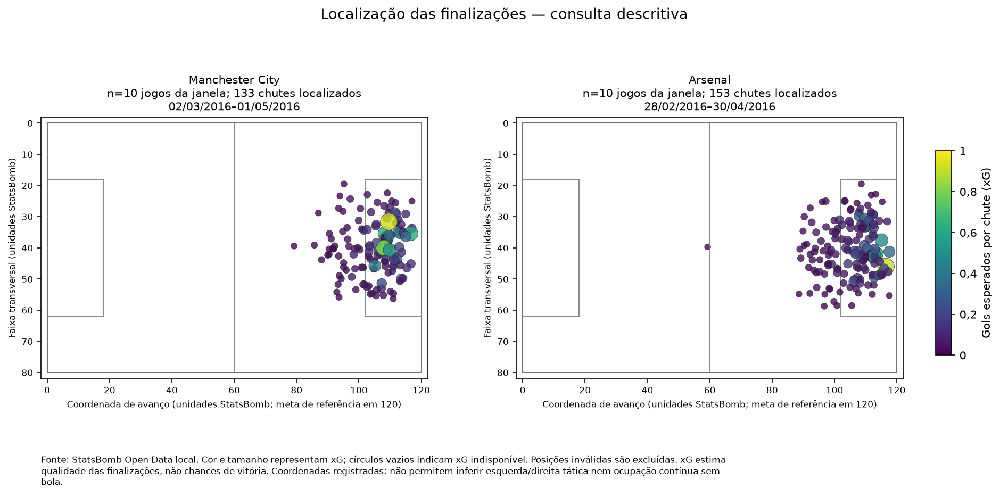
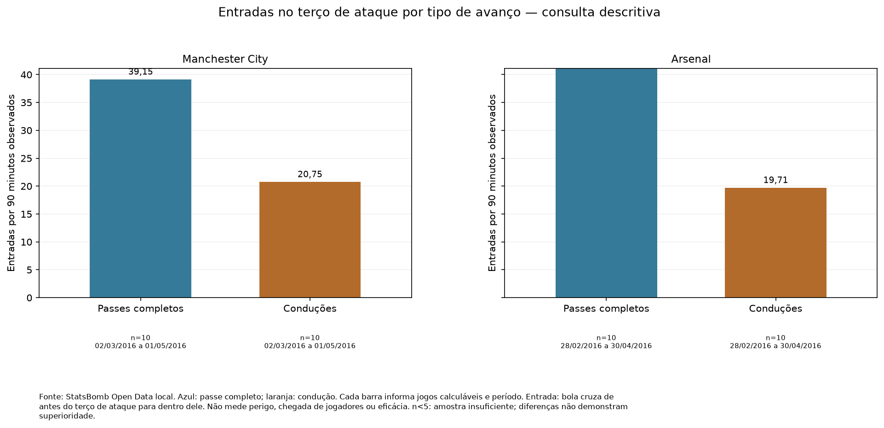

# Preparação pré-jogo — ManagerAI

A evidência continua limitada: adversários e datas podem diferir entre as janelas. As diferenças não comprovam superioridade ou eficácia de um ajuste.
Há registros ausentes ou ocorrências de qualidade nas partidas analisadas. A disponibilidade de cada indicador e as ocorrências constam dos detalhes técnicos.

## Visão geral do confronto

Manchester City × Arsenal — Premier League 2015/2016.

Referência histórica: 08/05/2016. O dia da referência fica fora da análise.

Manchester City: 10 jogos, de 02/03/2016 a 01/05/2016.

Arsenal: 10 jogos, de 28/02/2016 a 30/04/2016.

Este relatório usa dados históricos locais; não descreve os elencos ou a situação atual dos clubes.

Gols esperados (xG) representam a soma dos valores esperados das finalizações. xG estima a qualidade das finalizações. Não são uma contagem de chances, gols reais ou probabilidade de vencer.

## Conclusões sustentadas — resumo para a comissão técnica

- Finalizações por jogo: 13,30 por jogo para Manchester City (10 jogos; 02/03/2016 a 01/05/2016) e 15,30 por jogo para Arsenal (10 jogos; 28/02/2016 a 30/04/2016).
- Gols esperados a favor: 1,58 gols esperados por jogo para Manchester City (10 jogos; 02/03/2016 a 01/05/2016) e 1,50 gols esperados por jogo para Arsenal (10 jogos; 28/02/2016 a 30/04/2016).
- Gols esperados concedidos: 1,03 gols esperados por jogo para Manchester City (10 jogos; 02/03/2016 a 01/05/2016) e 0,75 gols esperados por jogo para Arsenal (10 jogos; 28/02/2016 a 30/04/2016).
- Passes certos: 81,93% para Manchester City (10 jogos; 02/03/2016 a 01/05/2016) e 83,79% para Arsenal (10 jogos; 28/02/2016 a 30/04/2016).
- Entradas no terço de ataque: 59,90 por 90 min para Manchester City (10 jogos; 02/03/2016 a 01/05/2016) e 63,54 por 90 min para Arsenal (10 jogos; 28/02/2016 a 30/04/2016).

## Indicadores observados (consulta descritiva)

A evidência continua limitada: adversários e datas podem diferir entre as janelas. As diferenças não comprovam superioridade ou eficácia de um ajuste.
Há registros ausentes ou ocorrências de qualidade nas partidas analisadas. A disponibilidade de cada indicador e as ocorrências constam dos detalhes técnicos.

As taxas por 90 min consideram o tempo observado, incluindo acréscimos. Indisponível significa ausência de informação calculável, nunca zero.

| Indicador | Unidade | Manchester City | Arsenal | Jogos disponíveis (equipe / adversário) | Período da equipe | Período do adversário | Como ler |
|---|---|---:|---:|---|---|---|---|
| Finalizações por jogo | por jogo | 13,30 | 15,30 | 10 / 10 | 02/03/2016 a 01/05/2016 | 28/02/2016 a 30/04/2016 | Quantidade média de chutes registrados. |
| Gols esperados a favor | gols esperados por jogo | 1,58 | 1,50 | 10 / 10 | 02/03/2016 a 01/05/2016 | 28/02/2016 a 30/04/2016 | Gols esperados (xG): soma dos valores esperados das finalizações. Não é quantidade de chances, gols reais ou probabilidade de vencer. |
| Finalizações permitidas por jogo | por jogo | 9,40 | 11,40 | 10 / 10 | 02/03/2016 a 01/05/2016 | 28/02/2016 a 30/04/2016 | Quantidade média de chutes dos adversários. |
| Gols esperados concedidos | gols esperados por jogo | 1,03 | 0,75 | 10 / 10 | 02/03/2016 a 01/05/2016 | 28/02/2016 a 30/04/2016 | Valor esperado dos chutes adversários. Não representa os gols efetivamente sofridos. |
| Passes certos | % | 81,93 | 83,79 | 10 / 10 | 02/03/2016 a 01/05/2016 | 28/02/2016 a 30/04/2016 | Percentual de passes completos entre os passes tentados. |
| Entradas no terço de ataque | por 90 min | 59,90 | 63,54 | 10 / 10 | 02/03/2016 a 01/05/2016 | 28/02/2016 a 30/04/2016 | Passes completos ou conduções que levam a bola de antes do terço de ataque para dentro dele. |
| Entradas na área por passe ou condução | por 90 min | 19,43 | 22,52 | 10 / 10 | 02/03/2016 a 01/05/2016 | 28/02/2016 a 30/04/2016 | Passes completos ou conduções que levam a bola de fora para dentro da área. Não conta toda forma possível de entrada. |
| Tentativas de pressão registradas | por 90 min | 143,26 | 127,07 | 10 / 10 | 02/03/2016 a 01/05/2016 | 28/02/2016 a 30/04/2016 | Quantidade de ações registradas; maior volume não significa pressão mais eficaz. |

## Observações descritivas do adversário

- Arsenal — finalizações por jogo: 15,30 por jogo, em 10 jogos com informação disponível (28/02/2016 a 30/04/2016). O volume não basta para afirmar que um ataque é mais forte; confira a localização e o contexto dos chutes.
- Arsenal — gols esperados a favor: 1,50 gols esperados por jogo, em 10 jogos com informação disponível (28/02/2016 a 30/04/2016). Esse valor descreve a qualidade estimada das finalizações, sem prever gols ou vitória no confronto.
- Arsenal — entradas no terço de ataque: 63,54 por 90 min, em 10 jogos com informação disponível (28/02/2016 a 30/04/2016). São avanços da bola por passe completo ou condução; a zona específica exige revisão em vídeo.
- Arsenal — tentativas de pressão registradas: 127,07 por 90 min, em 10 jogos com informação disponível (28/02/2016 a 30/04/2016). O número de ações não informa quantas pressões deram certo e não define sozinho um estilo de jogo.

## Possíveis ajustes para avaliar em treino ou vídeo

### Preparar a proteção das zonas de chegada

**O que foi observado:** Arsenal — entradas no terço de ataque: 63,54 por 90 min (10 jogos com informação disponível; 28/02/2016 a 30/04/2016); Manchester City — entradas no terço de ataque: 59,90 por 90 min (10 jogos com informação disponível; 02/03/2016 a 01/05/2016).

**Por que importa:** Essas ações registram avanços da bola até o terço de ataque; não mostram, sozinhas, o perigo de cada chegada.

**O que verificar ou testar:** Rever em vídeo como essas entradas acontecem e ensaiar coberturas em treino. A zona específica e a altura do bloco ainda precisam dessa verificação.

**Condição:** Há entradas observadas por passe completo/condução no histórico do adversário e comparação disponível com o próprio time.

**Antes de testar:**

- Revisar sequências em vídeo antes de escolher altura de bloco ou corredores prioritários.
- Confirmar em treino a capacidade de cobertura dos atletas disponíveis.

**Riscos:**

- Recuar o bloco pode conceder território e reduzir opções de saída.

**Limitações:**

- Sugestão exploratória: não foi demonstrado que esse ajuste melhora o desempenho.
- Histórico observado não garante repetição do comportamento no jogo-alvo.

### Rever a proteção dos espaços de finalização

**O que foi observado:** Arsenal — gols esperados a favor: 1,50 gols esperados por jogo (10 jogos com informação disponível; 28/02/2016 a 30/04/2016); Manchester City — gols esperados concedidos: 1,03 gols esperados por jogo (10 jogos com informação disponível; 02/03/2016 a 01/05/2016).

**Por que importa:** A qualidade estimada das finalizações complementa a contagem de chutes. A média não identifica onde está uma falha defensiva nem prevê gols no confronto.

**O que verificar ou testar:** Rever a localização e o contexto das finalizações nas partidas analisadas e testar a proteção desses espaços em treino, antes de escolher um ajuste defensivo.

**Condição:** O adversário criou chances com gols esperados positivos; há histórico de gols esperados permitidos do próprio time para comparação.

**Antes de testar:**

- Inspecionar localização e contexto dos chutes nas partidas-fonte; a média de gols esperados não identifica sozinha uma vulnerabilidade espacial.

**Riscos:**

- Priorizar a proteção da área pode aumentar a liberdade adversária em outras zonas.

**Limitações:**

- Sugestão exploratória: não foi demonstrado que esse ajuste melhora o desempenho.
- Histórico observado não garante repetição do comportamento no jogo-alvo.

## Informações declaradas pelo treinador

São um cenário de planejamento informado manualmente. Não alteram o cálculo nem os critérios das hipóteses nesta versão.

- Mando declarado: desconhecido.
- Contexto declarado: regular.
- Objetivo declarado: equilibrado.
- Jogadores indisponíveis declarados: 0; não há sugestão de substitutos.

Notas declaradas (texto do treinador, não verificado):

> Nenhuma nota informada.

## O que o sistema ainda não consegue recomendar

Formação ideal e escalação: Não suportado pelos dados atuais. Essa é uma limitação deliberada, não uma falha de execução.
O sistema não infere lesões, suspensões, disponibilidade presente, resultado do confronto ou eficácia comprovada de um ajuste.
As faixas espaciais não são chamadas automaticamente de esquerda ou direita: a orientação ainda precisa ser validada.

## Como conferir a análise

A apresentação vem do mesmo relatório calculado pela CLI. O relatório técnico em JSON preserva valores exatos, partidas, fórmulas e fontes. As hipóteses são exploratórias e exigem avaliação da comissão técnica.

Fonte: StatsBomb Open Data. Nenhum modelo foi treinado e nenhuma LLM foi utilizada.
## Análises táticas observáveis — V3

Os indicadores abaixo descrevem ações registradas em partidas anteriores. Não mostram posicionamento contínuo sem bola nem demonstram eficácia de um ajuste.

### Como o adversário ataca

Avanços, entradas e finalizações ajudam a selecionar situações para revisão em vídeo. As faixas do campo não são chamadas de esquerda ou direita tática.

| Equipe | Indicador | Valor | Jogos com informação | Período calculável | Como ler |
|---|---|---|---|---|---|
| Manchester City | Progressões por passe completo | 95,57 por 90 min | 10 | 02/03/2016 a 01/05/2016 | Avanços por passe completo ou condução que aproximam a bola da meta; critério de distância nos detalhes técnicos. |
| Manchester City | Avanços ao terço de ataque por passe completo | 39,15 por 90 min | 10 | 02/03/2016 a 01/05/2016 | A bola passa de antes do terço de ataque para dentro dele; não mede a chegada de jogadores. |
| Manchester City | Entradas na área por passe completo | 10,70 por 90 min | 10 | 02/03/2016 a 01/05/2016 | A bola passa de fora para dentro da área por esse tipo de ação; não comprova perigo ou eficácia. |
| Manchester City | Progressões por condução | 42,15 por 90 min | 10 | 02/03/2016 a 01/05/2016 | Avanços por passe completo ou condução que aproximam a bola da meta; critério de distância nos detalhes técnicos. |
| Manchester City | Avanços ao terço de ataque por condução | 20,75 por 90 min | 10 | 02/03/2016 a 01/05/2016 | A bola passa de antes do terço de ataque para dentro dele; não mede a chegada de jogadores. |
| Manchester City | Entradas na área por condução | 8,73 por 90 min | 10 | 02/03/2016 a 01/05/2016 | A bola passa de fora para dentro da área por esse tipo de ação; não comprova perigo ou eficácia. |
| Manchester City | Avanços ao terço de ataque pela faixa transversal de coordenada baixa | 38,40% | 10 | 02/03/2016 a 01/05/2016 | Parcela das entradas no terço de ataque com destino nessa faixa transversal; sem atribuir esquerda ou direita tática. |
| Manchester City | Avanços ao terço de ataque pela faixa central | 19,28% | 10 | 02/03/2016 a 01/05/2016 | Parcela das entradas no terço de ataque com destino nessa faixa transversal; sem atribuir esquerda ou direita tática. |
| Manchester City | Avanços ao terço de ataque pela faixa transversal de coordenada alta | 42,32% | 10 | 02/03/2016 a 01/05/2016 | Parcela das entradas no terço de ataque com destino nessa faixa transversal; sem atribuir esquerda ou direita tática. |
| Manchester City | Finalizações dentro da área | 66,17% | 10 | 02/03/2016 a 01/05/2016 | Parcela das finalizações com localização nessa zona; confira os jogos calculáveis. |
| Manchester City | Gols esperados em finalizações dentro da área | 1,42 gols esperados por jogo | 10 | 02/03/2016 a 01/05/2016 | Qualidade estimada das finalizações localizadas; não é contagem de chances nem probabilidade de vitória. |
| Manchester City | Finalizações fora da área | 33,83% | 10 | 02/03/2016 a 01/05/2016 | Parcela das finalizações com localização nessa zona; confira os jogos calculáveis. |
| Manchester City | Gols esperados em finalizações fora da área | 0,16 gols esperados por jogo | 10 | 02/03/2016 a 01/05/2016 | Qualidade estimada das finalizações localizadas; não é contagem de chances nem probabilidade de vitória. |
| Manchester City | Qualidade média das finalizações localizadas | 0,12 gols esperados por chute | 10 | 02/03/2016 a 01/05/2016 | Qualidade estimada das finalizações localizadas; não é contagem de chances nem probabilidade de vitória. |
| Arsenal | Progressões por passe completo | 116,94 por 90 min | 10 | 28/02/2016 a 30/04/2016 | Avanços por passe completo ou condução que aproximam a bola da meta; critério de distância nos detalhes técnicos. |
| Arsenal | Avanços ao terço de ataque por passe completo | 43,83 por 90 min | 10 | 28/02/2016 a 30/04/2016 | A bola passa de antes do terço de ataque para dentro dele; não mede a chegada de jogadores. |
| Arsenal | Entradas na área por passe completo | 16,14 por 90 min | 10 | 28/02/2016 a 30/04/2016 | A bola passa de fora para dentro da área por esse tipo de ação; não comprova perigo ou eficácia. |
| Arsenal | Progressões por condução | 41,95 por 90 min | 10 | 28/02/2016 a 30/04/2016 | Avanços por passe completo ou condução que aproximam a bola da meta; critério de distância nos detalhes técnicos. |
| Arsenal | Avanços ao terço de ataque por condução | 19,71 por 90 min | 10 | 28/02/2016 a 30/04/2016 | A bola passa de antes do terço de ataque para dentro dele; não mede a chegada de jogadores. |
| Arsenal | Entradas na área por condução | 6,38 por 90 min | 10 | 28/02/2016 a 30/04/2016 | A bola passa de fora para dentro da área por esse tipo de ação; não comprova perigo ou eficácia. |
| Arsenal | Avanços ao terço de ataque pela faixa transversal de coordenada baixa | 38,40% | 10 | 28/02/2016 a 30/04/2016 | Parcela das entradas no terço de ataque com destino nessa faixa transversal; sem atribuir esquerda ou direita tática. |
| Arsenal | Avanços ao terço de ataque pela faixa central | 25,26% | 10 | 28/02/2016 a 30/04/2016 | Parcela das entradas no terço de ataque com destino nessa faixa transversal; sem atribuir esquerda ou direita tática. |
| Arsenal | Avanços ao terço de ataque pela faixa transversal de coordenada alta | 36,34% | 10 | 28/02/2016 a 30/04/2016 | Parcela das entradas no terço de ataque com destino nessa faixa transversal; sem atribuir esquerda ou direita tática. |
| Arsenal | Finalizações dentro da área | 64,71% | 10 | 28/02/2016 a 30/04/2016 | Parcela das finalizações com localização nessa zona; confira os jogos calculáveis. |
| Arsenal | Gols esperados em finalizações dentro da área | 1,28 gols esperados por jogo | 10 | 28/02/2016 a 30/04/2016 | Qualidade estimada das finalizações localizadas; não é contagem de chances nem probabilidade de vitória. |
| Arsenal | Finalizações fora da área | 35,29% | 10 | 28/02/2016 a 30/04/2016 | Parcela das finalizações com localização nessa zona; confira os jogos calculáveis. |
| Arsenal | Gols esperados em finalizações fora da área | 0,22 gols esperados por jogo | 10 | 28/02/2016 a 30/04/2016 | Qualidade estimada das finalizações localizadas; não é contagem de chances nem probabilidade de vitória. |
| Arsenal | Qualidade média das finalizações localizadas | 0,10 gols esperados por chute | 10 | 28/02/2016 a 30/04/2016 | Qualidade estimada das finalizações localizadas; não é contagem de chances nem probabilidade de vitória. |

### Como ele pressiona e recupera a bola

Tentativas de pressão e registros de recuperação são descritos separadamente. A contagem não prova êxito nem que uma pressão causou uma recuperação.

| Equipe | Indicador | Valor | Jogos com informação | Período calculável | Como ler |
|---|---|---|---|---|---|
| Manchester City | Tentativas de pressão na faixa transversal de coordenada baixa | 34,99% | 10 | 02/03/2016 a 01/05/2016 | Parcela das tentativas de pressão registradas nessa faixa transversal; não mede sucesso. |
| Manchester City | Tentativas de pressão na faixa central | 26,93% | 10 | 02/03/2016 a 01/05/2016 | Parcela das tentativas de pressão registradas nessa faixa transversal; não mede sucesso. |
| Manchester City | Tentativas de pressão na faixa transversal de coordenada alta | 38,07% | 10 | 02/03/2016 a 01/05/2016 | Parcela das tentativas de pressão registradas nessa faixa transversal; não mede sucesso. |
| Manchester City | Tentativas de pressão no terço de origem | 31,85% | 10 | 02/03/2016 a 01/05/2016 | Tentativas de pressão localizadas nessa região; maior volume não comprova eficácia. |
| Manchester City | Tentativas de pressão no terço de origem por 90 | 45,63 por 90 min | 10 | 02/03/2016 a 01/05/2016 | Tentativas de pressão localizadas nessa região; maior volume não comprova eficácia. |
| Manchester City | Tentativas de pressão no terço intermediário | 45,61% | 10 | 02/03/2016 a 01/05/2016 | Tentativas de pressão localizadas nessa região; maior volume não comprova eficácia. |
| Manchester City | Tentativas de pressão no terço intermediário por 90 | 65,34 por 90 min | 10 | 02/03/2016 a 01/05/2016 | Tentativas de pressão localizadas nessa região; maior volume não comprova eficácia. |
| Manchester City | Tentativas de pressão no terço de ataque | 22,54% | 10 | 02/03/2016 a 01/05/2016 | Tentativas de pressão localizadas nessa região; maior volume não comprova eficácia. |
| Manchester City | Tentativas de pressão no terço de ataque por 90 | 32,29 por 90 min | 10 | 02/03/2016 a 01/05/2016 | Tentativas de pressão localizadas nessa região; maior volume não comprova eficácia. |
| Manchester City | Recuperações registradas | 51,82 por 90 min | 10 | 02/03/2016 a 01/05/2016 | Registros de recuperação de bola; não comprovam posse consolidada nem vínculo causal com uma pressão. |
| Manchester City | Recuperações com falha explícita | 3,10 por 90 min | 10 | 02/03/2016 a 01/05/2016 | Registros de recuperação que têm falha explicitamente marcada. |
| Manchester City | Recuperações sem falha explicitamente marcada | 0,00 por 90 min | 10 | 02/03/2016 a 01/05/2016 | Registros com ausência de falha explicitamente marcada; a marcação ausente não entra neste grupo. |
| Arsenal | Tentativas de pressão na faixa transversal de coordenada baixa | 35,08% | 10 | 28/02/2016 a 30/04/2016 | Parcela das tentativas de pressão registradas nessa faixa transversal; não mede sucesso. |
| Arsenal | Tentativas de pressão na faixa central | 31,02% | 10 | 28/02/2016 a 30/04/2016 | Parcela das tentativas de pressão registradas nessa faixa transversal; não mede sucesso. |
| Arsenal | Tentativas de pressão na faixa transversal de coordenada alta | 33,90% | 10 | 28/02/2016 a 30/04/2016 | Parcela das tentativas de pressão registradas nessa faixa transversal; não mede sucesso. |
| Arsenal | Tentativas de pressão no terço de origem | 28,73% | 10 | 28/02/2016 a 30/04/2016 | Tentativas de pressão localizadas nessa região; maior volume não comprova eficácia. |
| Arsenal | Tentativas de pressão no terço de origem por 90 | 36,51 por 90 min | 10 | 28/02/2016 a 30/04/2016 | Tentativas de pressão localizadas nessa região; maior volume não comprova eficácia. |
| Arsenal | Tentativas de pressão no terço intermediário | 48,23% | 10 | 28/02/2016 a 30/04/2016 | Tentativas de pressão localizadas nessa região; maior volume não comprova eficácia. |
| Arsenal | Tentativas de pressão no terço intermediário por 90 | 61,28 por 90 min | 10 | 28/02/2016 a 30/04/2016 | Tentativas de pressão localizadas nessa região; maior volume não comprova eficácia. |
| Arsenal | Tentativas de pressão no terço de ataque | 23,04% | 10 | 28/02/2016 a 30/04/2016 | Tentativas de pressão localizadas nessa região; maior volume não comprova eficácia. |
| Arsenal | Tentativas de pressão no terço de ataque por 90 | 29,28 por 90 min | 10 | 28/02/2016 a 30/04/2016 | Tentativas de pressão localizadas nessa região; maior volume não comprova eficácia. |
| Arsenal | Recuperações registradas | 52,84 por 90 min | 10 | 28/02/2016 a 30/04/2016 | Registros de recuperação de bola; não comprovam posse consolidada nem vínculo causal com uma pressão. |
| Arsenal | Recuperações com falha explícita | 4,04 por 90 min | 10 | 28/02/2016 a 30/04/2016 | Registros de recuperação que têm falha explicitamente marcada. |
| Arsenal | Recuperações sem falha explicitamente marcada | 0,00 por 90 min | 10 | 28/02/2016 a 30/04/2016 | Registros com ausência de falha explicitamente marcada; a marcação ausente não entra neste grupo. |

### Sequências ofensivas observadas

Blocos com ações ofensivas registradas não representam todas as posses reais nem tempo com a bola. Ações no mesmo bloco não demonstram causalidade. Jogos com inconsistências são excluídos dos agregados, sem converter ausências em zero.

| Equipe | Indicador | Valor | Jogos com informação | Período calculável |
|---|---|---|---|---|
| Manchester City | Blocos observados com ações ofensivas | 84,22 blocos observados por jogo | 9 | 02/03/2016 a 01/05/2016 |
| Manchester City | Blocos observados com entrada no terço de ataque ou na área | 49,08% | 9 | 02/03/2016 a 01/05/2016 |
| Manchester City | Blocos observados com finalização | 13,46% | 9 | 02/03/2016 a 01/05/2016 |
| Arsenal | Blocos observados com ações ofensivas | 80,29 blocos observados por jogo | 7 | 02/03/2016 a 30/04/2016 |
| Arsenal | Blocos observados com entrada no terço de ataque ou na área | 56,23% | 7 | 02/03/2016 a 30/04/2016 |
| Arsenal | Blocos observados com finalização | 15,66% | 7 | 02/03/2016 a 30/04/2016 |

- Manchester City — 20/03/2016: jogo não calculável para sequências (horários de ações fora de ordem ou inválidos).
- Arsenal — 28/02/2016: jogo não calculável para sequências (horários de ações fora de ordem ou inválidos).
- Arsenal — 02/04/2016: jogo não calculável para sequências (horários de ações fora de ordem ou inválidos).
- Arsenal — 17/04/2016: jogo não calculável para sequências (horários de ações fora de ordem ou inválidos).

### Padrões observados dos jogadores

Participação histórica em ordem alfabética, sem ranking: as contagens não medem capacidade nem são normalizadas por minutos. Disponibilidade no confronto é desconhecida. Formações são registros anteriores, sem indicar esquema ideal, posicionamento contínuo ou eficácia; mudanças são apenas as registradas nos dois tempos.

| Equipe | Jogador | Jogos com ações | Período das ações | Passes tentados | Passes completos | Conduções | Finalizações | Tentativas de pressão | Gols esperados acumulados | Disponibilidade no confronto |
|---|---|---|---|---|---|---|---|---|---|---|
| Manchester City | Aleksandar Kolarov | 7 | 02/03/2016 a 01/05/2016 | 379 | 269 | 273 | 8 | 64 | 0,30 gols esperados | desconhecida |
| Manchester City | Bacary Sagna | 4 | 05/03/2016 a 16/04/2016 | 257 | 215 | 160 | 2 | 44 | 0,08 gols esperados | desconhecida |
| Manchester City | David Josué Jiménez Silva | 6 | 02/03/2016 a 23/04/2016 | 440 | 378 | 366 | 5 | 85 | 0,31 gols esperados | desconhecida |
| Manchester City | Eliaquim Mangala | 7 | 20/03/2016 a 01/05/2016 | 287 | 254 | 216 | 1 | 88 | 0,14 gols esperados | desconhecida |
| Manchester City | Fabian Delph | 5 | 09/04/2016 a 01/05/2016 | 164 | 139 | 152 | 1 | 51 | 0,03 gols esperados | desconhecida |
| Manchester City | Fernando Francisco Reges | 7 | 02/03/2016 a 23/04/2016 | 318 | 279 | 239 | 5 | 133 | 0,35 gols esperados | desconhecida |
| Manchester City | Fernando Luiz Rosa | 8 | 02/03/2016 a 01/05/2016 | 424 | 367 | 356 | 6 | 164 | 0,30 gols esperados | desconhecida |
| Manchester City | Gaël Clichy | 6 | 02/03/2016 a 09/04/2016 | 401 | 322 | 302 | 1 | 63 | 0,02 gols esperados | desconhecida |
| Manchester City | Gnégnéri Yaya Touré | 6 | 05/03/2016 a 23/04/2016 | 385 | 324 | 300 | 7 | 66 | 0,75 gols esperados | desconhecida |
| Manchester City | Jesús Navas González | 10 | 02/03/2016 a 01/05/2016 | 501 | 378 | 464 | 8 | 158 | 0,37 gols esperados | desconhecida |
| Manchester City | Joe Hart | 9 | 02/03/2016 a 01/05/2016 | 239 | 140 | 101 | 0 | 1 | 0,00 gols esperados | desconhecida |
| Manchester City | Kelechi Promise Iheanacho | 7 | 02/03/2016 a 01/05/2016 | 135 | 105 | 125 | 10 | 47 | 2,28 gols esperados | desconhecida |
| Manchester City | Kevin De Bruyne | 4 | 02/04/2016 a 19/04/2016 | 154 | 123 | 145 | 10 | 54 | 0,67 gols esperados | desconhecida |
| Manchester City | Manuel García Alonso | 1 | 05/03/2016 a 05/03/2016 | 19 | 19 | 15 | 0 | 3 | 0,00 gols esperados | desconhecida |
| Manchester City | Martín Gastón Demichelis | 3 | 20/03/2016 a 01/05/2016 | 75 | 67 | 58 | 1 | 26 | 0,12 gols esperados | desconhecida |
| Manchester City | Nicolás Hernán Otamendi | 8 | 02/03/2016 a 01/05/2016 | 427 | 372 | 318 | 5 | 89 | 0,24 gols esperados | desconhecida |
| Manchester City | Pablo Javier Zabaleta Girod | 8 | 02/03/2016 a 01/05/2016 | 394 | 334 | 282 | 0 | 102 | 0,00 gols esperados | desconhecida |
| Manchester City | Raheem Sterling | 6 | 02/03/2016 a 01/05/2016 | 116 | 94 | 139 | 4 | 68 | 0,75 gols esperados | desconhecida |
| Manchester City | Samir Nasri | 4 | 02/04/2016 a 01/05/2016 | 214 | 197 | 205 | 6 | 56 | 1,38 gols esperados | desconhecida |
| Manchester City | Sergio Leonel Agüero del Castillo | 9 | 02/03/2016 a 23/04/2016 | 304 | 248 | 388 | 33 | 91 | 6,43 gols esperados | desconhecida |
| Manchester City | Vincent Kompany | 4 | 02/03/2016 a 19/04/2016 | 198 | 165 | 135 | 4 | 33 | 0,18 gols esperados | desconhecida |
| Manchester City | Wilfredo Daniel Caballero | 2 | 20/03/2016 a 02/04/2016 | 40 | 25 | 17 | 0 | 0 | 0,00 gols esperados | desconhecida |
| Manchester City | Wilfried Guemiand Bony | 8 | 02/03/2016 a 01/05/2016 | 129 | 102 | 114 | 16 | 40 | 1,11 gols esperados | desconhecida |
| Arsenal | Aaron Ramsey | 8 | 28/02/2016 a 30/04/2016 | 577 | 492 | 517 | 7 | 156 | 0,63 gols esperados | desconhecida |
| Arsenal | Alex Iwobi | 8 | 28/02/2016 a 30/04/2016 | 338 | 282 | 346 | 15 | 92 | 1,72 gols esperados | desconhecida |
| Arsenal | Alexis Alejandro Sánchez Sánchez | 10 | 28/02/2016 a 30/04/2016 | 513 | 386 | 540 | 32 | 144 | 2,64 gols esperados | desconhecida |
| Arsenal | Calum Chambers | 1 | 19/03/2016 a 19/03/2016 | 5 | 4 | 4 | 0 | 6 | 0,00 gols esperados | desconhecida |
| Arsenal | Daniel Nii Tackie Mensah Welbeck | 9 | 28/02/2016 a 30/04/2016 | 143 | 118 | 176 | 18 | 102 | 2,45 gols esperados | desconhecida |
| Arsenal | David Ospina Ramírez | 4 | 05/03/2016 a 09/04/2016 | 127 | 74 | 47 | 0 | 0 | 0,00 gols esperados | desconhecida |
| Arsenal | Francis Joseph Coquelin | 9 | 28/02/2016 a 30/04/2016 | 392 | 347 | 315 | 3 | 137 | 0,09 gols esperados | desconhecida |
| Arsenal | Gabriel Armando de Abreu | 8 | 28/02/2016 a 30/04/2016 | 425 | 393 | 323 | 3 | 48 | 0,16 gols esperados | desconhecida |
| Arsenal | Héctor Bellerín Moruno | 10 | 28/02/2016 a 30/04/2016 | 628 | 524 | 478 | 7 | 90 | 0,33 gols esperados | desconhecida |
| Arsenal | Ignacio Monreal Eraso | 9 | 28/02/2016 a 30/04/2016 | 550 | 476 | 381 | 8 | 98 | 0,91 gols esperados | desconhecida |
| Arsenal | Jack Wilshere | 1 | 24/04/2016 a 24/04/2016 | 9 | 9 | 12 | 0 | 4 | 0,00 gols esperados | desconhecida |
| Arsenal | Joel Nathaniel Campbell Samuels | 4 | 02/03/2016 a 21/04/2016 | 62 | 49 | 69 | 4 | 20 | 0,30 gols esperados | desconhecida |
| Arsenal | Kieran Gibbs | 2 | 05/03/2016 a 19/03/2016 | 63 | 42 | 37 | 0 | 16 | 0,00 gols esperados | desconhecida |
| Arsenal | Laurent Koscielny | 8 | 28/02/2016 a 30/04/2016 | 477 | 432 | 349 | 5 | 54 | 0,87 gols esperados | desconhecida |
| Arsenal | Mathieu Flamini | 1 | 05/03/2016 a 05/03/2016 | 2 | 2 | 0 | 0 | 0 | 0,00 gols esperados | desconhecida |
| Arsenal | Mesut Özil | 10 | 28/02/2016 a 30/04/2016 | 788 | 637 | 609 | 17 | 115 | 1,91 gols esperados | desconhecida |
| Arsenal | Mohamed Naser Elsayed Elneny | 9 | 28/02/2016 a 30/04/2016 | 690 | 636 | 576 | 11 | 147 | 0,44 gols esperados | desconhecida |
| Arsenal | Olivier Giroud | 10 | 28/02/2016 a 30/04/2016 | 177 | 126 | 109 | 18 | 76 | 1,73 gols esperados | desconhecida |
| Arsenal | Per Mertesacker | 5 | 02/03/2016 a 30/04/2016 | 275 | 247 | 178 | 3 | 29 | 0,22 gols esperados | desconhecida |
| Arsenal | Petr Čech | 6 | 28/02/2016 a 30/04/2016 | 203 | 129 | 115 | 0 | 1 | 0,00 gols esperados | desconhecida |
| Arsenal | Theo Walcott | 7 | 28/02/2016 a 24/04/2016 | 45 | 32 | 51 | 2 | 19 | 0,55 gols esperados | desconhecida |

### Formações históricas registradas

| Equipe | Formação inicial registrada | Jogos nessa formação | Jogos com formação inicial calculável | Parcela dos jogos calculáveis | Período dos registros |
|---|---|---|---|---|---|
| Manchester City | 4-4-2 | 5 | 10 | 50,00% | 05/03/2016 a 01/05/2016 |
| Manchester City | 4-2-3-1 | 5 | 10 | 50,00% | 02/03/2016 a 19/04/2016 |
| Arsenal | 4-2-3-1 | 10 | 10 | 100,00% | 28/02/2016 a 30/04/2016 |

### Mudanças de formação registradas

| Equipe | Data do registro | Formação registrada na mudança | Tempo do registro | Jogos deste registro |
|---|---|---|---|---|
| Manchester City | 02/03/2016 | 4-2-3-1 | 2º tempo | 1 |
| Manchester City | 05/03/2016 | 4-4-1-1 | 2º tempo | 1 |
| Manchester City | 12/03/2016 | 4-2-3-1 | 2º tempo | 1 |
| Manchester City | 12/03/2016 | 4-2-2-2 | 2º tempo | 1 |
| Manchester City | 20/03/2016 | 4-2-3-1 | 1º tempo | 1 |
| Manchester City | 20/03/2016 | 4-2-3-1 | 2º tempo | 1 |
| Manchester City | 20/03/2016 | 4-4-2 | 2º tempo | 1 |
| Manchester City | 02/04/2016 | 4-2-3-1 | 2º tempo | 1 |
| Manchester City | 09/04/2016 | 4-4-2 | 2º tempo | 1 |
| Manchester City | 01/05/2016 | 4-4-2 | 2º tempo | 1 |
| Arsenal | 28/02/2016 | 4-2-3-1 | 1º tempo | 1 |
| Arsenal | 02/03/2016 | 4-2-3-1 | 2º tempo | 1 |
| Arsenal | 19/03/2016 | 4-2-3-1 | 2º tempo | 1 |
| Arsenal | 02/04/2016 | 4-2-3-1 | 2º tempo | 1 |
| Arsenal | 09/04/2016 | 4-2-3-1 | 2º tempo | 1 |
| Arsenal | 17/04/2016 | 4-2-3-1 | 2º tempo | 1 |
| Arsenal | 17/04/2016 | 4-2-3-1 | 2º tempo | 1 |
| Arsenal | 21/04/2016 | 4-2-3-1 | 2º tempo | 1 |
| Arsenal | 30/04/2016 | 4-2-3-1 | 2º tempo | 1 |

### Hipóteses para testar

#### Avaliar a proteção das recepções no terço de ataque

**Observação registrada:** Arsenal: 43,83 entradas por passe e 19,71 por condução a cada 90 min (10 jogos); passes representam 68,98% dessas entradas. Manchester City: 39,15 entradas por passe a cada 90 min (10 jogos).

**O que testar:** Selecionar em vídeo as recepções que cruzam o limite do terço de ataque e ensaiar cobertura do receptor e da linha de passe.

**Condição:** Pelo menos 5 jogos calculáveis em cada indicador citado; passes representam ao menos 60% das entradas observadas do adversário.

**Antes de testar:**

- Conferir em vídeo as ações e seus destinos antes de escolher o ajuste.
- Testar em treino com os jogadores historicamente observados, sem presumir disponibilidade no alvo.

**Riscos:**

- Fechar linhas de passe pode abrir espaço para conduções; a contagem não identifica sozinha a zona mais perigosa.

**Limitações:**

- Associação descritiva, sem demonstração de eficácia ou causalidade.
- Adversários, datas e contextos das janelas podem diferir; 5 jogos é somente um mínimo operacional.

#### Rever a proteção das zonas de finalização dentro da área

**Observação registrada:** Arsenal: 64,71% dos chutes localizados partiram da área (10 jogos); gols esperados desses chutes: 1,28 por jogo (10 jogos). Manchester City: 66,17% dos chutes localizados partiram da área (10 jogos).

**O que testar:** Usar o mapa para selecionar lances dentro da área e testar proteção do espaço antes do chute, após rever o início de cada jogada.

**Condição:** Pelo menos 5 jogos em cada métrica citada; ao menos 60% dos chutes localizados do adversário partiram da área.

**Antes de testar:**

- Conferir em vídeo as ações e seus destinos antes de escolher o ajuste.
- Testar em treino com os jogadores historicamente observados, sem presumir disponibilidade no alvo.

**Riscos:**

- Concentrar a proteção na área pode permitir finalizações de fora e não elimina a qualidade dos chutes concedidos.

**Limitações:**

- Associação descritiva, sem demonstração de eficácia ou causalidade.
- Adversários, datas e contextos das janelas podem diferir; 5 jogos é somente um mínimo operacional.

Fonte: StatsBomb Open Data local. As partidas, denominadores, fórmulas e referências de cada hipótese estão nos detalhes técnicos e no JSON. Os indicadores não estimam probabilidade de vitória.

## Apêndice técnico — indicadores e rastreabilidade

### Relatório histórico de apoio pré-jogo

**Manchester City × Arsenal — Premier League 2015/2016**

Corte: 2016-05-08T17:00:00.000. Somente datas anteriores; o dia do corte é excluído.
Amostra: 10 jogos da equipe e 10 jogos do adversário.

#### Período observado

- Manchester City: 2016-03-02 a 2016-05-01; evidência limitada.
- Arsenal: 2016-02-28 a 2016-04-30; evidência limitada.

#### Indicadores comparáveis

Taxas e proporções usam denominadores agregados; n indica jogos com métrica calculável.

| Indicador | Unidade | Equipe | n | Período da equipe | Adversário | n | Período do adversário |
|---|---|---:|---:|---|---:|---:|---|
| xG a favor | xG/jogo | 1,58 | 10 | 02/03/2016 a 01/05/2016 | 1,50 | 10 | 28/02/2016 a 30/04/2016 |
| xG contra | xG/jogo | 1,03 | 10 | 02/03/2016 a 01/05/2016 | 0,75 | 10 | 28/02/2016 a 30/04/2016 |
| Finalizações a favor | eventos/jogo | 13,30 | 10 | 02/03/2016 a 01/05/2016 | 15,30 | 10 | 28/02/2016 a 30/04/2016 |
| Finalizações contra | eventos/jogo | 9,40 | 10 | 02/03/2016 a 01/05/2016 | 11,40 | 10 | 28/02/2016 a 30/04/2016 |
| xG por chute | xG/chute | 0,12 | 10 | 02/03/2016 a 01/05/2016 | 0,10 | 10 | 28/02/2016 a 30/04/2016 |
| Acerto de passe | % | 81,93 | 10 | 02/03/2016 a 01/05/2016 | 83,79 | 10 | 28/02/2016 a 30/04/2016 |
| Acerto com pressão marcada | % | 74,71 | 10 | 02/03/2016 a 01/05/2016 | 76,42 | 10 | 28/02/2016 a 30/04/2016 |
| Acerto com ausência explícita de pressão | % | não disponível | 0 | sem informação calculável | não disponível | 0 | sem informação calculável |
| Acerto com pressão não marcada | % | 83,45 | 10 | 02/03/2016 a 01/05/2016 | 84,90 | 10 | 28/02/2016 a 30/04/2016 |
| Entradas no terço final por passe completo/condução | eventos/90 | 59,90 | 10 | 02/03/2016 a 01/05/2016 | 63,54 | 10 | 28/02/2016 a 30/04/2016 |
| Tentativas de entrada no terço final | eventos/90 | 78,30 | 10 | 02/03/2016 a 01/05/2016 | 81,65 | 10 | 28/02/2016 a 30/04/2016 |
| Entradas na área por passe completo/condução | eventos/90 | 19,43 | 10 | 02/03/2016 a 01/05/2016 | 22,52 | 10 | 28/02/2016 a 30/04/2016 |
| Eventos de pressão | eventos/90 | 143,26 | 10 | 02/03/2016 a 01/05/2016 | 127,07 | 10 | 28/02/2016 a 30/04/2016 |
| Pressões no terço ofensivo | % | 22,54 | 10 | 02/03/2016 a 01/05/2016 | 23,04 | 10 | 28/02/2016 a 30/04/2016 |
| Pressure com contrapressão marcada | eventos/90 | 35,77 | 10 | 02/03/2016 a 01/05/2016 | 35,38 | 10 | 28/02/2016 a 30/04/2016 |
| Eventos de recuperação | eventos/90 | 51,82 | 10 | 02/03/2016 a 01/05/2016 | 52,84 | 10 | 28/02/2016 a 30/04/2016 |
| Eventos de interceptação | eventos/90 | 18,31 | 10 | 02/03/2016 a 01/05/2016 | 16,14 | 10 | 28/02/2016 a 30/04/2016 |
| Duelos do tipo Tackle | eventos/90 | 19,43 | 10 | 02/03/2016 a 01/05/2016 | 17,17 | 10 | 28/02/2016 a 30/04/2016 |
| Ações localizadas em y menor que 80/3 | % | 34,61 | 10 | 02/03/2016 a 01/05/2016 | 32,30 | 10 | 28/02/2016 a 30/04/2016 |
| Ações localizadas no corredor central | % | 29,63 | 10 | 02/03/2016 a 01/05/2016 | 33,26 | 10 | 28/02/2016 a 30/04/2016 |
| Ações localizadas em y maior ou igual a 160/3 | % | 35,76 | 10 | 02/03/2016 a 01/05/2016 | 34,44 | 10 | 28/02/2016 a 30/04/2016 |

#### Achados observáveis

- Comparação descritiva: xg a favor. Equipe: 1,58 xG/jogo; adversário: 1,50 xG/jogo.
  Evidências: team_profile.metrics.xg_for, opponent_profile.metrics.xg_for.
- Comparação descritiva: xg contra. Equipe: 1,03 xG/jogo; adversário: 0,75 xG/jogo.
  Evidências: team_profile.metrics.xg_against, opponent_profile.metrics.xg_against.
- Comparação descritiva: entradas no terço final por passe completo/condução. Equipe: 59,90 eventos/90; adversário: 63,54 eventos/90.
  Evidências: team_profile.metrics.final_third_entries, opponent_profile.metrics.final_third_entries.
- Comparação descritiva: eventos de pressão. Equipe: 143,26 eventos/90; adversário: 127,07 eventos/90.
  Evidências: team_profile.metrics.pressures, opponent_profile.metrics.pressures.

Diferenças observadas não demonstram superioridade, vulnerabilidade causal ou eficácia de uma estratégia.

#### Hipóteses condicionais para investigação

##### R01_PROGRESSAO

Investigar a proteção das zonas de chegada do adversário e ensaiar respostas às entradas no terço final.

Condição: Há entradas observadas por passe completo/condução no histórico do adversário e comparação disponível com o próprio time.
Evidências: opponent_profile.metrics.final_third_entries, team_profile.metrics.final_third_entries.
Qualidade da evidência: limitada.

Pré-condições:

- Revisar sequências em vídeo antes de escolher altura de bloco ou corredores prioritários.
- Confirmar em treino a capacidade de cobertura dos atletas disponíveis.

Riscos:

- Recuar o bloco pode conceder território e reduzir opções de saída.

Limitações:

- Regra exploratória sem validação causal ou de eficácia.
- Histórico observado não garante repetição do comportamento no jogo-alvo.

##### R03_CHANCES

Investigar a proteção da área e dos espaços de finalização antes de definir ajustes defensivos.

Condição: O adversário criou chances com xG positivo; há histórico de xG concedido do próprio time para comparação.
Evidências: opponent_profile.metrics.xg_for, team_profile.metrics.xg_against.
Qualidade da evidência: limitada.

Pré-condições:

- Inspecionar localização e contexto dos chutes nas partidas-fonte; a média de xG não identifica sozinha uma vulnerabilidade espacial.

Riscos:

- Priorizar a proteção da área pode aumentar a liberdade adversária em outras zonas.

Limitações:

- Regra exploratória sem validação causal ou de eficácia.
- Histórico observado não garante repetição do comportamento no jogo-alvo.

#### Formação e escalação

Não suportado pelos dados atuais.

#### Contexto informado pelo treinador

Mando declarado: desconhecido. Contexto declarado: regular.
Objetivo declarado: equilibrado.
Indisponíveis declarados (IDs): nenhum informado

Notas declaradas (texto do treinador, não verificado):

> Nenhuma nota informada.

#### Lacunas e limites

- Adversário: locations_missing=204; consultar metodologia e dicionário de dados.
- Adversário: pass_accuracy_explicit_no_pressure calculável em 0/10 jogos.
- Ausência de marcação under_pressure é mantida separada de False explícito.
- Equipe: locations_missing=195; consultar metodologia e dicionário de dados.
- Equipe: pass_accuracy_explicit_no_pressure calculável em 0/10 jogos.
- Eventos não equivalem a tracking; a análise não usa dados 360 nem posicionamento integral sem bola.
- Formação e escalação: não suportado pelos dados atuais; formações registradas não comprovam adequação tática ou disponibilidade.
- Não há inferência de lesões, suspensões, rivalidade, importância competitiva ou mando real.
- Orientação preservada como registrada; corredores usam intervalos de y, sem inferir esquerda/direita tática.

#### Metodologia e rastreabilidade

- Determinístico e descritivo; sem treinamento ou inferência causal.
- Somente datas anteriores ao corte; mesmo dia excluído conservadoramente. Nunca lê eventos ou escalações do alvo.
- Soma do maior timestamp + duration em cada período 1 e 2, em minutos; proxy de exposição observada, inclui acréscimos.
- Médias por jogo para contagens/xG; taxas por 90 e proporções agregadas por soma dos numeradores/denominadores. Mediana e DP entre jogos válidos.
- Plano StatsBomb 120×80, não metros. Coordenadas inválidas excluídas só dos cálculos espaciais.
- Menos de 5 jogos: insuficiente. A partir de 5: evidência limitada, sem confiança probabilística.
- Contexto e notas são declarações do treinador, não fatos verificados nem fatores causais.
- Template determinístico em português; nenhuma chamada a LLM.
- Fonte: StatsBomb Open Data; consultar README e LICENSE.pdf do conjunto local.

Versão das fórmulas: 1.0.0; regras: 1.0.0.
Fingerprint SHA-256 dos arquivos efetivamente lidos: `a35bcbeb3d42705618b1c4463f32ceb6383f19a73699ab6cd3662096db40c915`.
IDs das partidas, valores individuais, medianas, desvios-padrão, numeradores, denominadores e hashes das fontes estão em report.json.

## Visualizações

