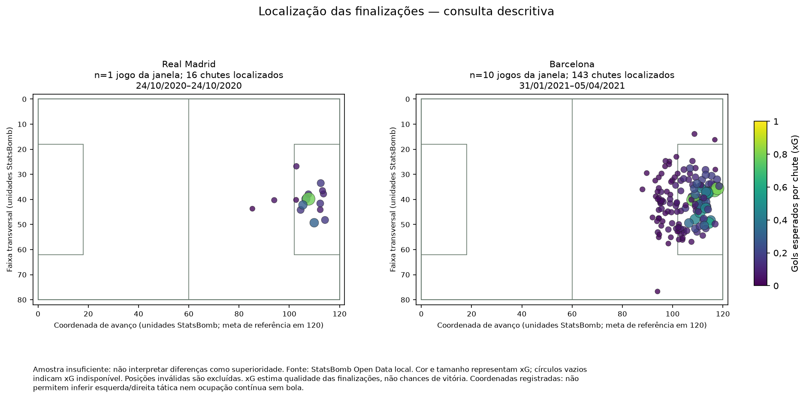
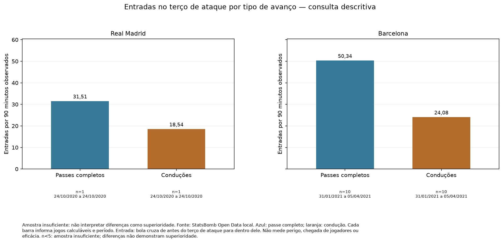

# Preparação pré-jogo — ManagerAI

Amostra insuficiente — Real Madrid: pelo menos um indicador central tem apenas 1 jogo com informação calculável. Histórico insuficiente para comparação confiável. Os valores são uma consulta descritiva; não interpretar diferenças como superioridade. Não são apresentadas conclusões comparativas nem hipóteses de ajuste.
Há registros ausentes ou ocorrências de qualidade nas partidas analisadas. A disponibilidade de cada indicador e as ocorrências constam dos detalhes técnicos.

## Visão geral do confronto

Real Madrid × Barcelona — La Liga 2020/2021.

Referência histórica: 10/04/2021. O dia da referência fica fora da análise.

Real Madrid: 1 jogo, de 24/10/2020 a 24/10/2020.

Barcelona: 10 jogos, de 31/01/2021 a 05/04/2021.

Este relatório usa dados históricos locais; não descreve os elencos ou a situação atual dos clubes.

Gols esperados (xG) representam a soma dos valores esperados das finalizações. xG estima a qualidade das finalizações. Não são uma contagem de chances, gols reais ou probabilidade de vencer.

## Conclusões sustentadas — resumo para a comissão técnica

Não há histórico comparável suficiente para descrever diferenças entre as equipes.

## Indicadores observados (consulta descritiva)

Amostra insuficiente — Real Madrid: pelo menos um indicador central tem apenas 1 jogo com informação calculável. Histórico insuficiente para comparação confiável. Os valores são uma consulta descritiva; não interpretar diferenças como superioridade. Não são apresentadas conclusões comparativas nem hipóteses de ajuste.
Há registros ausentes ou ocorrências de qualidade nas partidas analisadas. A disponibilidade de cada indicador e as ocorrências constam dos detalhes técnicos.

As taxas por 90 min consideram o tempo observado, incluindo acréscimos. Indisponível significa ausência de informação calculável, nunca zero.

| Indicador | Unidade | Real Madrid | Barcelona | Jogos disponíveis (equipe / adversário) | Período da equipe | Período do adversário | Como ler |
|---|---|---:|---:|---|---|---|---|
| Finalizações por jogo | por jogo | 16,00 | 14,30 | 1 / 10 | 24/10/2020 a 24/10/2020 | 31/01/2021 a 05/04/2021 | Quantidade média de chutes registrados. |
| Gols esperados a favor | gols esperados por jogo | 2,90 | 1,87 | 1 / 10 | 24/10/2020 a 24/10/2020 | 31/01/2021 a 05/04/2021 | Gols esperados (xG): soma dos valores esperados das finalizações. Não é quantidade de chances, gols reais ou probabilidade de vencer. |
| Finalizações permitidas por jogo | por jogo | 10,00 | 6,80 | 1 / 10 | 24/10/2020 a 24/10/2020 | 31/01/2021 a 05/04/2021 | Quantidade média de chutes dos adversários. |
| Gols esperados concedidos | gols esperados por jogo | 1,25 | 0,84 | 1 / 10 | 24/10/2020 a 24/10/2020 | 31/01/2021 a 05/04/2021 | Valor esperado dos chutes adversários. Não representa os gols efetivamente sofridos. |
| Passes certos | % | 86,83 | 90,26 | 1 / 10 | 24/10/2020 a 24/10/2020 | 31/01/2021 a 05/04/2021 | Percentual de passes completos entre os passes tentados. |
| Entradas no terço de ataque | por 90 min | 50,05 | 74,42 | 1 / 10 | 24/10/2020 a 24/10/2020 | 31/01/2021 a 05/04/2021 | Passes completos ou conduções que levam a bola de antes do terço de ataque para dentro dele. |
| Entradas na área por passe ou condução | por 90 min | 18,54 | 21,53 | 1 / 10 | 24/10/2020 a 24/10/2020 | 31/01/2021 a 05/04/2021 | Passes completos ou conduções que levam a bola de fora para dentro da área. Não conta toda forma possível de entrada. |
| Tentativas de pressão registradas | por 90 min | 183,52 | 129,01 | 1 / 10 | 24/10/2020 a 24/10/2020 | 31/01/2021 a 05/04/2021 | Quantidade de ações registradas; maior volume não significa pressão mais eficaz. |

## Observações descritivas do adversário

- Barcelona — finalizações por jogo: 14,30 por jogo, em 10 jogos com informação disponível (31/01/2021 a 05/04/2021). O volume não basta para afirmar que um ataque é mais forte; confira a localização e o contexto dos chutes.
- Barcelona — gols esperados a favor: 1,87 gols esperados por jogo, em 10 jogos com informação disponível (31/01/2021 a 05/04/2021). Esse valor descreve a qualidade estimada das finalizações, sem prever gols ou vitória no confronto.
- Barcelona — entradas no terço de ataque: 74,42 por 90 min, em 10 jogos com informação disponível (31/01/2021 a 05/04/2021). São avanços da bola por passe completo ou condução; a zona específica exige revisão em vídeo.
- Barcelona — tentativas de pressão registradas: 129,01 por 90 min, em 10 jogos com informação disponível (31/01/2021 a 05/04/2021). O número de ações não informa quantas pressões deram certo e não define sozinho um estilo de jogo.

## Possíveis ajustes para avaliar em treino ou vídeo

Não foram emitidas hipóteses: o histórico ou as evidências não atendem aos critérios mínimos. Não completamos sugestões artificialmente.
## Informações declaradas pelo treinador

São um cenário de planejamento informado manualmente. Não alteram o cálculo nem os critérios das hipóteses nesta versão.

- Mando declarado: desconhecido.
- Contexto declarado: regular.
- Objetivo declarado: equilibrado.
- Jogadores indisponíveis declarados: 0; não há sugestão de substitutos.

Notas declaradas (texto do treinador, não verificado):

> Nenhuma nota informada.

## O que o sistema ainda não consegue recomendar

Formação ideal e escalação: Não suportado pelos dados atuais. Essa é uma limitação deliberada, não uma falha de execução.
O sistema não infere lesões, suspensões, disponibilidade presente, resultado do confronto ou eficácia comprovada de um ajuste.
As faixas espaciais não são chamadas automaticamente de esquerda ou direita: a orientação ainda precisa ser validada.

## Como conferir a análise

A apresentação vem do mesmo relatório calculado pela CLI. O relatório técnico em JSON preserva valores exatos, partidas, fórmulas e fontes. As hipóteses são exploratórias e exigem avaliação da comissão técnica.

Fonte: StatsBomb Open Data. Nenhum modelo foi treinado e nenhuma LLM foi utilizada.
## Análises táticas observáveis — V3

**Amostra insuficiente:** consulta descritiva. Não interpretar diferenças como superioridade. Não são apresentadas hipóteses de ajuste.

Os indicadores abaixo descrevem ações registradas em partidas anteriores. Não mostram posicionamento contínuo sem bola nem demonstram eficácia de um ajuste.

### Como o adversário ataca

Avanços, entradas e finalizações ajudam a selecionar situações para revisão em vídeo. As faixas do campo não são chamadas de esquerda ou direita tática.

| Equipe | Indicador | Valor | Jogos com informação | Período calculável | Como ler |
|---|---|---|---|---|---|
| Real Madrid | Progressões por passe completo | 100,10 por 90 min | 1 | 24/10/2020 a 24/10/2020 | Avanços por passe completo ou condução que aproximam a bola da meta; critério de distância nos detalhes técnicos. |
| Real Madrid | Avanços ao terço de ataque por passe completo | 31,51 por 90 min | 1 | 24/10/2020 a 24/10/2020 | A bola passa de antes do terço de ataque para dentro dele; não mede a chegada de jogadores. |
| Real Madrid | Entradas na área por passe completo | 10,20 por 90 min | 1 | 24/10/2020 a 24/10/2020 | A bola passa de fora para dentro da área por esse tipo de ação; não comprova perigo ou eficácia. |
| Real Madrid | Progressões por condução | 51,91 por 90 min | 1 | 24/10/2020 a 24/10/2020 | Avanços por passe completo ou condução que aproximam a bola da meta; critério de distância nos detalhes técnicos. |
| Real Madrid | Avanços ao terço de ataque por condução | 18,54 por 90 min | 1 | 24/10/2020 a 24/10/2020 | A bola passa de antes do terço de ataque para dentro dele; não mede a chegada de jogadores. |
| Real Madrid | Entradas na área por condução | 8,34 por 90 min | 1 | 24/10/2020 a 24/10/2020 | A bola passa de fora para dentro da área por esse tipo de ação; não comprova perigo ou eficácia. |
| Real Madrid | Avanços ao terço de ataque pela faixa transversal de coordenada baixa | 44,44% | 1 | 24/10/2020 a 24/10/2020 | Parcela das entradas no terço de ataque com destino nessa faixa transversal; sem atribuir esquerda ou direita tática. |
| Real Madrid | Avanços ao terço de ataque pela faixa central | 16,67% | 1 | 24/10/2020 a 24/10/2020 | Parcela das entradas no terço de ataque com destino nessa faixa transversal; sem atribuir esquerda ou direita tática. |
| Real Madrid | Avanços ao terço de ataque pela faixa transversal de coordenada alta | 38,89% | 1 | 24/10/2020 a 24/10/2020 | Parcela das entradas no terço de ataque com destino nessa faixa transversal; sem atribuir esquerda ou direita tática. |
| Real Madrid | Finalizações dentro da área | 87,50% | 1 | 24/10/2020 a 24/10/2020 | Parcela das finalizações com localização nessa zona; confira os jogos calculáveis. |
| Real Madrid | Gols esperados em finalizações dentro da área | 2,84 gols esperados por jogo | 1 | 24/10/2020 a 24/10/2020 | Qualidade estimada das finalizações localizadas; não é contagem de chances nem probabilidade de vitória. |
| Real Madrid | Finalizações fora da área | 12,50% | 1 | 24/10/2020 a 24/10/2020 | Parcela das finalizações com localização nessa zona; confira os jogos calculáveis. |
| Real Madrid | Gols esperados em finalizações fora da área | 0,06 gols esperados por jogo | 1 | 24/10/2020 a 24/10/2020 | Qualidade estimada das finalizações localizadas; não é contagem de chances nem probabilidade de vitória. |
| Real Madrid | Qualidade média das finalizações localizadas | 0,18 gols esperados por chute | 1 | 24/10/2020 a 24/10/2020 | Qualidade estimada das finalizações localizadas; não é contagem de chances nem probabilidade de vitória. |
| Barcelona | Progressões por passe completo | 106,06 por 90 min | 10 | 31/01/2021 a 05/04/2021 | Avanços por passe completo ou condução que aproximam a bola da meta; critério de distância nos detalhes técnicos. |
| Barcelona | Avanços ao terço de ataque por passe completo | 50,34 por 90 min | 10 | 31/01/2021 a 05/04/2021 | A bola passa de antes do terço de ataque para dentro dele; não mede a chegada de jogadores. |
| Barcelona | Entradas na área por passe completo | 14,07 por 90 min | 10 | 31/01/2021 a 05/04/2021 | A bola passa de fora para dentro da área por esse tipo de ação; não comprova perigo ou eficácia. |
| Barcelona | Progressões por condução | 51,76 por 90 min | 10 | 31/01/2021 a 05/04/2021 | Avanços por passe completo ou condução que aproximam a bola da meta; critério de distância nos detalhes técnicos. |
| Barcelona | Avanços ao terço de ataque por condução | 24,08 por 90 min | 10 | 31/01/2021 a 05/04/2021 | A bola passa de antes do terço de ataque para dentro dele; não mede a chegada de jogadores. |
| Barcelona | Entradas na área por condução | 7,46 por 90 min | 10 | 31/01/2021 a 05/04/2021 | A bola passa de fora para dentro da área por esse tipo de ação; não comprova perigo ou eficácia. |
| Barcelona | Avanços ao terço de ataque pela faixa transversal de coordenada baixa | 35,03% | 10 | 31/01/2021 a 05/04/2021 | Parcela das entradas no terço de ataque com destino nessa faixa transversal; sem atribuir esquerda ou direita tática. |
| Barcelona | Avanços ao terço de ataque pela faixa central | 23,73% | 10 | 31/01/2021 a 05/04/2021 | Parcela das entradas no terço de ataque com destino nessa faixa transversal; sem atribuir esquerda ou direita tática. |
| Barcelona | Avanços ao terço de ataque pela faixa transversal de coordenada alta | 41,24% | 10 | 31/01/2021 a 05/04/2021 | Parcela das entradas no terço de ataque com destino nessa faixa transversal; sem atribuir esquerda ou direita tática. |
| Barcelona | Finalizações dentro da área | 60,14% | 10 | 31/01/2021 a 05/04/2021 | Parcela das finalizações com localização nessa zona; confira os jogos calculáveis. |
| Barcelona | Gols esperados em finalizações dentro da área | 1,64 gols esperados por jogo | 10 | 31/01/2021 a 05/04/2021 | Qualidade estimada das finalizações localizadas; não é contagem de chances nem probabilidade de vitória. |
| Barcelona | Finalizações fora da área | 39,86% | 10 | 31/01/2021 a 05/04/2021 | Parcela das finalizações com localização nessa zona; confira os jogos calculáveis. |
| Barcelona | Gols esperados em finalizações fora da área | 0,24 gols esperados por jogo | 10 | 31/01/2021 a 05/04/2021 | Qualidade estimada das finalizações localizadas; não é contagem de chances nem probabilidade de vitória. |
| Barcelona | Qualidade média das finalizações localizadas | 0,13 gols esperados por chute | 10 | 31/01/2021 a 05/04/2021 | Qualidade estimada das finalizações localizadas; não é contagem de chances nem probabilidade de vitória. |

### Como ele pressiona e recupera a bola

Tentativas de pressão e registros de recuperação são descritos separadamente. A contagem não prova êxito nem que uma pressão causou uma recuperação.

| Equipe | Indicador | Valor | Jogos com informação | Período calculável | Como ler |
|---|---|---|---|---|---|
| Real Madrid | Tentativas de pressão na faixa transversal de coordenada baixa | 30,81% | 1 | 24/10/2020 a 24/10/2020 | Parcela das tentativas de pressão registradas nessa faixa transversal; não mede sucesso. |
| Real Madrid | Tentativas de pressão na faixa central | 34,85% | 1 | 24/10/2020 a 24/10/2020 | Parcela das tentativas de pressão registradas nessa faixa transversal; não mede sucesso. |
| Real Madrid | Tentativas de pressão na faixa transversal de coordenada alta | 34,34% | 1 | 24/10/2020 a 24/10/2020 | Parcela das tentativas de pressão registradas nessa faixa transversal; não mede sucesso. |
| Real Madrid | Tentativas de pressão no terço de origem | 44,44% | 1 | 24/10/2020 a 24/10/2020 | Tentativas de pressão localizadas nessa região; maior volume não comprova eficácia. |
| Real Madrid | Tentativas de pressão no terço de origem por 90 | 81,57 por 90 min | 1 | 24/10/2020 a 24/10/2020 | Tentativas de pressão localizadas nessa região; maior volume não comprova eficácia. |
| Real Madrid | Tentativas de pressão no terço intermediário | 35,35% | 1 | 24/10/2020 a 24/10/2020 | Tentativas de pressão localizadas nessa região; maior volume não comprova eficácia. |
| Real Madrid | Tentativas de pressão no terço intermediário por 90 | 64,88 por 90 min | 1 | 24/10/2020 a 24/10/2020 | Tentativas de pressão localizadas nessa região; maior volume não comprova eficácia. |
| Real Madrid | Tentativas de pressão no terço de ataque | 20,20% | 1 | 24/10/2020 a 24/10/2020 | Tentativas de pressão localizadas nessa região; maior volume não comprova eficácia. |
| Real Madrid | Tentativas de pressão no terço de ataque por 90 | 37,08 por 90 min | 1 | 24/10/2020 a 24/10/2020 | Tentativas de pressão localizadas nessa região; maior volume não comprova eficácia. |
| Real Madrid | Recuperações registradas | 50,05 por 90 min | 1 | 24/10/2020 a 24/10/2020 | Registros de recuperação de bola; não comprovam posse consolidada nem vínculo causal com uma pressão. |
| Real Madrid | Recuperações com falha explícita | 3,71 por 90 min | 1 | 24/10/2020 a 24/10/2020 | Registros de recuperação que têm falha explicitamente marcada. |
| Real Madrid | Recuperações sem falha explicitamente marcada | 0,00 por 90 min | 1 | 24/10/2020 a 24/10/2020 | Registros com ausência de falha explicitamente marcada; a marcação ausente não entra neste grupo. |
| Barcelona | Tentativas de pressão na faixa transversal de coordenada baixa | 31,63% | 10 | 31/01/2021 a 05/04/2021 | Parcela das tentativas de pressão registradas nessa faixa transversal; não mede sucesso. |
| Barcelona | Tentativas de pressão na faixa central | 25,77% | 10 | 31/01/2021 a 05/04/2021 | Parcela das tentativas de pressão registradas nessa faixa transversal; não mede sucesso. |
| Barcelona | Tentativas de pressão na faixa transversal de coordenada alta | 42,61% | 10 | 31/01/2021 a 05/04/2021 | Parcela das tentativas de pressão registradas nessa faixa transversal; não mede sucesso. |
| Barcelona | Tentativas de pressão no terço de origem | 24,45% | 10 | 31/01/2021 a 05/04/2021 | Tentativas de pressão localizadas nessa região; maior volume não comprova eficácia. |
| Barcelona | Tentativas de pressão no terço de origem por 90 | 31,55 por 90 min | 10 | 31/01/2021 a 05/04/2021 | Tentativas de pressão localizadas nessa região; maior volume não comprova eficácia. |
| Barcelona | Tentativas de pressão no terço intermediário | 48,10% | 10 | 31/01/2021 a 05/04/2021 | Tentativas de pressão localizadas nessa região; maior volume não comprova eficácia. |
| Barcelona | Tentativas de pressão no terço intermediário por 90 | 62,05 por 90 min | 10 | 31/01/2021 a 05/04/2021 | Tentativas de pressão localizadas nessa região; maior volume não comprova eficácia. |
| Barcelona | Tentativas de pressão no terço de ataque | 27,45% | 10 | 31/01/2021 a 05/04/2021 | Tentativas de pressão localizadas nessa região; maior volume não comprova eficácia. |
| Barcelona | Tentativas de pressão no terço de ataque por 90 | 35,42 por 90 min | 10 | 31/01/2021 a 05/04/2021 | Tentativas de pressão localizadas nessa região; maior volume não comprova eficácia. |
| Barcelona | Recuperações registradas | 37,40 por 90 min | 10 | 31/01/2021 a 05/04/2021 | Registros de recuperação de bola; não comprovam posse consolidada nem vínculo causal com uma pressão. |
| Barcelona | Recuperações com falha explícita | 3,02 por 90 min | 10 | 31/01/2021 a 05/04/2021 | Registros de recuperação que têm falha explicitamente marcada. |
| Barcelona | Recuperações sem falha explicitamente marcada | 0,00 por 90 min | 10 | 31/01/2021 a 05/04/2021 | Registros com ausência de falha explicitamente marcada; a marcação ausente não entra neste grupo. |

### Sequências ofensivas observadas

Blocos com ações ofensivas registradas não representam todas as posses reais nem tempo com a bola. Ações no mesmo bloco não demonstram causalidade. Jogos com inconsistências são excluídos dos agregados, sem converter ausências em zero.

| Equipe | Indicador | Valor | Jogos com informação | Período calculável |
|---|---|---|---|---|
| Real Madrid | Blocos observados com ações ofensivas | 75,00 blocos observados por jogo | 1 | 24/10/2020 a 24/10/2020 |
| Real Madrid | Blocos observados com entrada no terço de ataque ou na área | 49,33% | 1 | 24/10/2020 a 24/10/2020 |
| Real Madrid | Blocos observados com finalização | 18,67% | 1 | 24/10/2020 a 24/10/2020 |
| Barcelona | Blocos observados com ações ofensivas | 85,00 blocos observados por jogo | 7 | 31/01/2021 a 15/03/2021 |
| Barcelona | Blocos observados com entrada no terço de ataque ou na área | 53,78% | 7 | 31/01/2021 a 15/03/2021 |
| Barcelona | Blocos observados com finalização | 15,46% | 7 | 31/01/2021 a 15/03/2021 |

- Barcelona — 27/02/2021: jogo não calculável para sequências (horários de ações fora de ordem ou inválidos).
- Barcelona — 21/03/2021: jogo não calculável para sequências (horários de ações fora de ordem ou inválidos).
- Barcelona — 05/04/2021: jogo não calculável para sequências (horários de ações fora de ordem ou inválidos).

### Padrões observados dos jogadores

Participação histórica em ordem alfabética, sem ranking: as contagens não medem capacidade nem são normalizadas por minutos. Disponibilidade no confronto é desconhecida. Formações são registros anteriores, sem indicar esquema ideal, posicionamento contínuo ou eficácia; mudanças são apenas as registradas nos dois tempos.

| Equipe | Jogador | Jogos com ações | Período das ações | Passes tentados | Passes completos | Conduções | Finalizações | Tentativas de pressão | Gols esperados acumulados | Disponibilidade no confronto |
|---|---|---|---|---|---|---|---|---|---|---|
| Real Madrid | Carlos Henrique Casimiro | 1 | 24/10/2020 a 24/10/2020 | 55 | 50 | 42 | 1 | 21 | 0,02 gols esperados | desconhecida |
| Real Madrid | Federico Santiago Valverde Dipetta | 1 | 24/10/2020 a 24/10/2020 | 35 | 29 | 33 | 1 | 22 | 0,31 gols esperados | desconhecida |
| Real Madrid | Ferland Mendy | 1 | 24/10/2020 a 24/10/2020 | 55 | 47 | 43 | 0 | 12 | 0,00 gols esperados | desconhecida |
| Real Madrid | José Ignacio Fernández Iglesias | 1 | 24/10/2020 a 24/10/2020 | 34 | 30 | 30 | 0 | 10 | 0,00 gols esperados | desconhecida |
| Real Madrid | Karim Benzema | 1 | 24/10/2020 a 24/10/2020 | 39 | 36 | 24 | 3 | 12 | 0,36 gols esperados | desconhecida |
| Real Madrid | Lucas Vázquez Iglesias | 1 | 24/10/2020 a 24/10/2020 | 33 | 27 | 28 | 0 | 10 | 0,00 gols esperados | desconhecida |
| Real Madrid | Luka Modrić | 1 | 24/10/2020 a 24/10/2020 | 12 | 10 | 12 | 1 | 4 | 0,29 gols esperados | desconhecida |
| Real Madrid | Marco Asensio Willemsen | 1 | 24/10/2020 a 24/10/2020 | 34 | 26 | 28 | 0 | 16 | 0,00 gols esperados | desconhecida |
| Real Madrid | Raphaël Varane | 1 | 24/10/2020 a 24/10/2020 | 59 | 54 | 47 | 2 | 7 | 0,26 gols esperados | desconhecida |
| Real Madrid | Rodrygo Silva de Goes | 1 | 24/10/2020 a 24/10/2020 | 8 | 7 | 8 | 0 | 6 | 0,00 gols esperados | desconhecida |
| Real Madrid | Sergio Ramos García | 1 | 24/10/2020 a 24/10/2020 | 58 | 55 | 40 | 4 | 15 | 1,14 gols esperados | desconhecida |
| Real Madrid | Thibaut Courtois | 1 | 24/10/2020 a 24/10/2020 | 31 | 26 | 16 | 0 | 0 | 0,00 gols esperados | desconhecida |
| Real Madrid | Toni Kroos | 1 | 24/10/2020 a 24/10/2020 | 77 | 66 | 53 | 2 | 33 | 0,33 gols esperados | desconhecida |
| Real Madrid | Vinícius José Paixão de Oliveira Júnior | 1 | 24/10/2020 a 24/10/2020 | 47 | 38 | 53 | 2 | 30 | 0,19 gols esperados | desconhecida |
| Barcelona | Antoine Griezmann | 9 | 31/01/2021 a 05/04/2021 | 348 | 315 | 282 | 14 | 108 | 2,63 gols esperados | desconhecida |
| Barcelona | Clément Lenglet | 10 | 31/01/2021 a 05/04/2021 | 702 | 642 | 598 | 4 | 99 | 0,34 gols esperados | desconhecida |
| Barcelona | Francisco António Machado Mota de Castro Trincão | 7 | 07/02/2021 a 05/04/2021 | 130 | 117 | 136 | 9 | 48 | 1,64 gols esperados | desconhecida |
| Barcelona | Frenkie de Jong | 10 | 31/01/2021 a 05/04/2021 | 873 | 828 | 736 | 3 | 76 | 0,58 gols esperados | desconhecida |
| Barcelona | Gerard Piqué Bernabéu | 3 | 21/02/2021 a 27/02/2021 | 245 | 226 | 199 | 0 | 17 | 0,00 gols esperados | desconhecida |
| Barcelona | Héctor Junior Firpo Adames | 2 | 13/02/2021 a 06/03/2021 | 66 | 62 | 48 | 1 | 9 | 0,78 gols esperados | desconhecida |
| Barcelona | Jordi Alba Ramos | 9 | 31/01/2021 a 05/04/2021 | 701 | 607 | 559 | 8 | 104 | 1,15 gols esperados | desconhecida |
| Barcelona | Lionel Andrés Messi Cuccittini | 10 | 31/01/2021 a 05/04/2021 | 694 | 578 | 730 | 51 | 68 | 6,55 gols esperados | desconhecida |
| Barcelona | Marc-André ter Stegen | 10 | 31/01/2021 a 05/04/2021 | 347 | 305 | 230 | 0 | 0 | 0,00 gols esperados | desconhecida |
| Barcelona | Martin Braithwaite Christensen | 9 | 31/01/2021 a 05/04/2021 | 66 | 51 | 72 | 3 | 26 | 0,15 gols esperados | desconhecida |
| Barcelona | Miralem Pjanić | 5 | 31/01/2021 a 24/02/2021 | 244 | 223 | 193 | 3 | 18 | 0,18 gols esperados | desconhecida |
| Barcelona | Moriba Kourouma Kourouma | 6 | 13/02/2021 a 05/04/2021 | 148 | 139 | 141 | 3 | 37 | 0,29 gols esperados | desconhecida |
| Barcelona | Ousmane Dembélé | 10 | 31/01/2021 a 05/04/2021 | 348 | 303 | 375 | 26 | 91 | 2,54 gols esperados | desconhecida |
| Barcelona | Pedro González López | 10 | 31/01/2021 a 05/04/2021 | 588 | 523 | 534 | 3 | 212 | 0,14 gols esperados | desconhecida |
| Barcelona | Ricard Puig Martí | 7 | 07/02/2021 a 05/04/2021 | 232 | 211 | 182 | 3 | 27 | 0,13 gols esperados | desconhecida |
| Barcelona | Ronald Federico Araújo da Silva | 6 | 31/01/2021 a 05/04/2021 | 115 | 107 | 96 | 2 | 15 | 0,20 gols esperados | desconhecida |
| Barcelona | Samuel Yves Umtiti | 6 | 31/01/2021 a 06/03/2021 | 268 | 257 | 209 | 0 | 23 | 0,00 gols esperados | desconhecida |
| Barcelona | Sergi Roberto Carnicer | 1 | 31/01/2021 a 31/01/2021 | 18 | 16 | 15 | 0 | 3 | 0,00 gols esperados | desconhecida |
| Barcelona | Sergino Dest | 8 | 13/02/2021 a 05/04/2021 | 384 | 350 | 346 | 6 | 95 | 1,07 gols esperados | desconhecida |
| Barcelona | Sergio Busquets i Burgos | 9 | 07/02/2021 a 05/04/2021 | 710 | 650 | 555 | 0 | 155 | 0,00 gols esperados | desconhecida |
| Barcelona | Óscar Mingueza García | 10 | 31/01/2021 a 05/04/2021 | 639 | 590 | 518 | 4 | 135 | 0,38 gols esperados | desconhecida |

### Formações históricas registradas

| Equipe | Formação inicial registrada | Jogos nessa formação | Jogos com formação inicial calculável | Parcela dos jogos calculáveis | Período dos registros |
|---|---|---|---|---|---|
| Real Madrid | 4-3-3 | 1 | 1 | 100,00% | 24/10/2020 a 24/10/2020 |
| Barcelona | 3-5-2 | 2 | 10 | 20,00% | 27/02/2021 a 06/03/2021 |
| Barcelona | 4-3-3 | 4 | 10 | 40,00% | 07/02/2021 a 24/02/2021 |
| Barcelona | 3-4-2-1 | 3 | 10 | 30,00% | 15/03/2021 a 05/04/2021 |
| Barcelona | 4-2-3-1 | 1 | 10 | 10,00% | 31/01/2021 a 31/01/2021 |

### Mudanças de formação registradas

| Equipe | Data do registro | Formação registrada na mudança | Tempo do registro | Jogos deste registro |
|---|---|---|---|---|
| Barcelona | 31/01/2021 | 3-4-2-1 | 2º tempo | 1 |
| Barcelona | 07/02/2021 | 4-2-3-1 | 2º tempo | 1 |
| Barcelona | 07/02/2021 | 4-2-3-1 | 2º tempo | 1 |
| Barcelona | 13/02/2021 | 4-3-3 | 2º tempo | 1 |
| Barcelona | 21/02/2021 | 4-3-3 | 2º tempo | 1 |
| Barcelona | 21/02/2021 | 4-3-3 | 2º tempo | 1 |
| Barcelona | 21/02/2021 | 4-2-3-1 | 2º tempo | 1 |
| Barcelona | 21/02/2021 | 4-3-3 | 2º tempo | 1 |
| Barcelona | 24/02/2021 | 4-2-3-1 | 2º tempo | 1 |
| Barcelona | 06/03/2021 | 4-3-3 | 2º tempo | 1 |
| Barcelona | 15/03/2021 | 3-4-2-1 | 2º tempo | 1 |
| Barcelona | 21/03/2021 | 3-4-2-1 | 2º tempo | 1 |
| Barcelona | 21/03/2021 | 3-5-2 | 2º tempo | 1 |
| Barcelona | 05/04/2021 | 4-1-4-1 | 2º tempo | 1 |
| Barcelona | 05/04/2021 | 4-3-3 | 2º tempo | 1 |

### Hipóteses para testar

Nenhuma hipótese V3 emitida: a amostra ou as evidências não atendem aos critérios operacionais.

Fonte: StatsBomb Open Data local. As partidas, denominadores, fórmulas e referências de cada hipótese estão nos detalhes técnicos e no JSON. Os indicadores não estimam probabilidade de vitória.

## Apêndice técnico — indicadores e rastreabilidade

### Relatório histórico de apoio pré-jogo

**Real Madrid × Barcelona — La Liga 2020/2021**

Corte: 2021-04-10T21:00:00.000. Somente datas anteriores; o dia do corte é excluído.
Amostra: 1 jogo da equipe e 10 jogos do adversário.

Amostra insuficiente — Real Madrid: pelo menos um indicador central tem apenas 1 jogo com informação calculável. Histórico insuficiente para comparação confiável. Os valores são uma consulta descritiva; não interpretar diferenças como superioridade. Não são apresentadas conclusões comparativas nem hipóteses de ajuste.

#### Período observado

- Real Madrid: 2020-10-24 a 2020-10-24; evidência insuficiente.
- Barcelona: 2021-01-31 a 2021-04-05; evidência limitada.

#### Indicadores comparáveis

Taxas e proporções usam denominadores agregados; n indica jogos com métrica calculável.

| Indicador | Unidade | Equipe | n | Período da equipe | Adversário | n | Período do adversário |
|---|---|---:|---:|---|---:|---:|---|
| xG a favor | xG/jogo | 2,90 | 1 | 24/10/2020 a 24/10/2020 | 1,87 | 10 | 31/01/2021 a 05/04/2021 |
| xG contra | xG/jogo | 1,25 | 1 | 24/10/2020 a 24/10/2020 | 0,84 | 10 | 31/01/2021 a 05/04/2021 |
| Finalizações a favor | eventos/jogo | 16,00 | 1 | 24/10/2020 a 24/10/2020 | 14,30 | 10 | 31/01/2021 a 05/04/2021 |
| Finalizações contra | eventos/jogo | 10,00 | 1 | 24/10/2020 a 24/10/2020 | 6,80 | 10 | 31/01/2021 a 05/04/2021 |
| xG por chute | xG/chute | 0,18 | 1 | 24/10/2020 a 24/10/2020 | 0,13 | 10 | 31/01/2021 a 05/04/2021 |
| Acerto de passe | % | 86,83 | 1 | 24/10/2020 a 24/10/2020 | 90,26 | 10 | 31/01/2021 a 05/04/2021 |
| Acerto com pressão marcada | % | 75,00 | 1 | 24/10/2020 a 24/10/2020 | 82,45 | 10 | 31/01/2021 a 05/04/2021 |
| Acerto com ausência explícita de pressão | % | não disponível | 0 | sem informação calculável | não disponível | 0 | sem informação calculável |
| Acerto com pressão não marcada | % | 88,30 | 1 | 24/10/2020 a 24/10/2020 | 91,31 | 10 | 31/01/2021 a 05/04/2021 |
| Entradas no terço final por passe completo/condução | eventos/90 | 50,05 | 1 | 24/10/2020 a 24/10/2020 | 74,42 | 10 | 31/01/2021 a 05/04/2021 |
| Tentativas de entrada no terço final | eventos/90 | 63,03 | 1 | 24/10/2020 a 24/10/2020 | 85,66 | 10 | 31/01/2021 a 05/04/2021 |
| Entradas na área por passe completo/condução | eventos/90 | 18,54 | 1 | 24/10/2020 a 24/10/2020 | 21,53 | 10 | 31/01/2021 a 05/04/2021 |
| Eventos de pressão | eventos/90 | 183,52 | 1 | 24/10/2020 a 24/10/2020 | 129,01 | 10 | 31/01/2021 a 05/04/2021 |
| Pressões no terço ofensivo | % | 20,20 | 1 | 24/10/2020 a 24/10/2020 | 27,45 | 10 | 31/01/2021 a 05/04/2021 |
| Pressure com contrapressão marcada | eventos/90 | 26,88 | 1 | 24/10/2020 a 24/10/2020 | 33,25 | 10 | 31/01/2021 a 05/04/2021 |
| Eventos de recuperação | eventos/90 | 50,05 | 1 | 24/10/2020 a 24/10/2020 | 37,40 | 10 | 31/01/2021 a 05/04/2021 |
| Eventos de interceptação | eventos/90 | 10,20 | 1 | 24/10/2020 a 24/10/2020 | 10,11 | 10 | 31/01/2021 a 05/04/2021 |
| Duelos do tipo Tackle | eventos/90 | 23,17 | 1 | 24/10/2020 a 24/10/2020 | 13,51 | 10 | 31/01/2021 a 05/04/2021 |
| Ações localizadas em y menor que 80/3 | % | 34,89 | 1 | 24/10/2020 a 24/10/2020 | 31,70 | 10 | 31/01/2021 a 05/04/2021 |
| Ações localizadas no corredor central | % | 32,02 | 1 | 24/10/2020 a 24/10/2020 | 35,79 | 10 | 31/01/2021 a 05/04/2021 |
| Ações localizadas em y maior ou igual a 160/3 | % | 33,09 | 1 | 24/10/2020 a 24/10/2020 | 32,51 | 10 | 31/01/2021 a 05/04/2021 |

#### Achados observáveis

- Comparação descritiva: xg a favor. Equipe: 2,90 xG/jogo; adversário: 1,87 xG/jogo.
  Evidências: team_profile.metrics.xg_for, opponent_profile.metrics.xg_for.
- Comparação descritiva: xg contra. Equipe: 1,25 xG/jogo; adversário: 0,84 xG/jogo.
  Evidências: team_profile.metrics.xg_against, opponent_profile.metrics.xg_against.
- Comparação descritiva: entradas no terço final por passe completo/condução. Equipe: 50,05 eventos/90; adversário: 74,42 eventos/90.
  Evidências: team_profile.metrics.final_third_entries, opponent_profile.metrics.final_third_entries.
- Comparação descritiva: eventos de pressão. Equipe: 183,52 eventos/90; adversário: 129,01 eventos/90.
  Evidências: team_profile.metrics.pressures, opponent_profile.metrics.pressures.

Diferenças observadas não demonstram superioridade, vulnerabilidade causal ou eficácia de uma estratégia.

#### Hipóteses condicionais para investigação

Hipóteses não emitidas: amostra ou evidência insuficiente para as regras.
#### Formação e escalação

Não suportado pelos dados atuais.

#### Contexto informado pelo treinador

Mando declarado: desconhecido. Contexto declarado: regular.
Objetivo declarado: equilibrado.
Indisponíveis declarados (IDs): nenhum informado

Notas declaradas (texto do treinador, não verificado):

> Nenhuma nota informada.

#### Lacunas e limites

- Adversário: locations_missing=273; consultar metodologia e dicionário de dados.
- Adversário: pass_accuracy_explicit_no_pressure calculável em 0/10 jogos.
- Ausência de marcação under_pressure é mantida separada de False explícito.
- Equipe: amostra insuficiente (1 jogo; mínimo operacional 5).
- Equipe: locations_missing=27; consultar metodologia e dicionário de dados.
- Equipe: pass_accuracy_explicit_no_pressure calculável em 0/1 jogo.
- Eventos não equivalem a tracking; a análise não usa dados 360 nem posicionamento integral sem bola.
- Formação e escalação: não suportado pelos dados atuais; formações registradas não comprovam adequação tática ou disponibilidade.
- Nenhuma hipótese emitida: amostra ou evidências não satisfazem as regras documentadas.
- Não há inferência de lesões, suspensões, rivalidade, importância competitiva ou mando real.
- Orientação preservada como registrada; corredores usam intervalos de y, sem inferir esquerda/direita tática.

#### Metodologia e rastreabilidade

- Determinístico e descritivo; sem treinamento ou inferência causal.
- Somente datas anteriores ao corte; mesmo dia excluído conservadoramente. Nunca lê eventos ou escalações do alvo.
- Soma do maior timestamp + duration em cada período 1 e 2, em minutos; proxy de exposição observada, inclui acréscimos.
- Médias por jogo para contagens/xG; taxas por 90 e proporções agregadas por soma dos numeradores/denominadores. Mediana e DP entre jogos válidos.
- Plano StatsBomb 120×80, não metros. Coordenadas inválidas excluídas só dos cálculos espaciais.
- Menos de 5 jogos: insuficiente. A partir de 5: evidência limitada, sem confiança probabilística.
- Contexto e notas são declarações do treinador, não fatos verificados nem fatores causais.
- Template determinístico em português; nenhuma chamada a LLM.
- Fonte: StatsBomb Open Data; consultar README e LICENSE.pdf do conjunto local.

Versão das fórmulas: 1.0.0; regras: 1.0.0.
Fingerprint SHA-256 dos arquivos efetivamente lidos: `e547c2cdfd9b7a6e91c714ac06e8b5f9feee5e9316e701daa61d330a285af5ab`.
IDs das partidas, valores individuais, medianas, desvios-padrão, numeradores, denominadores e hashes das fontes estão em report.json.

## Visualizações

